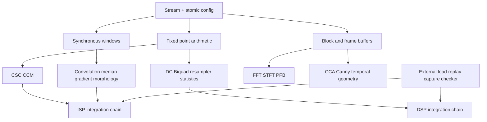

# DSP / ISP reusable library

Status: active development, **not production accepted**. The acceptance contract
is the archived `docs/original_acceptance_goal.md` (all 16 DSP, 19 ISP and 7 infrastructure items).
The existing active thread goal incorporates that file; no token budget is set.
Hybrid NTT and the previous whole-repository audit remain separate open work.

New cores use a single clock and active-low synchronous reset, Stream
`tdata/tvalid/tready`, and image `tuser=SOF`, `tlast=EOL`. This takes precedence
over the legacy asynchronous-reset/clock-enable examples in IP_CORE_SOP.
Existing accepted RTL, golden values and historical evidence are preserved.

## Ownership

- Main agent: central requirements, shared interfaces, integration, build tools,
  window foundation and exclusive hardware scheduling.
- stream_foundation: `infra/stream/` only.
- dsp_inventory: `dsp/` only; audit and independent models before stream gate.
- isp_inventory: `isp/` only; audit and independent models before stream gate.

## Gates

Each requirement needs a supported configuration, independent floating-point
and bit-exact model, RTL, protocol/numerical tests including checker mutation,
isolated synthesis, constrained P&R, externally supplied board vectors,
reprogram/retest, production integration, traceable packaging and documentation.
An old manifest, a simulation PASS, or a fixed on-board digest is not acceptance.

Board: Tang Primer 20K DOCK, GW2A-LV18PG256C8/I7, 27 MHz. Every delivered
image must be <=15000 LUT-class and <=4 Gowin DSP-class, with BRAM/FF and
timing checked separately. Arithmetic synthesis uses `synth_gowin -noalu`.
Use `scripts/env.ps1`; SRAM programming is authorized, persistent Flash is not.
Main agent must acquire `.boardlock` exclusively and record image on release.
Latest pre-task evidence: `artifacts/board_recheck_20260925_020111/SESSION.md`.
That establishes output capture only; fresh external injection remains a gate.

## Execution sequence and dependency graph

1. Stream register/FIFO contract and tests; synchronous 3x3/5x5 window contract.
2. DSP DC/statistics/Biquad/resampler/spectrum and ISP CSC/window operators.
3. Halfband/Farrow/Hilbert/Goertzel/STFT and statistics/equalization/LSC/CCM/formats.
4. 5x5/scale/Bayer and correlation/AGC/DDC/DUC.
5. LMS/PFB/recovery loops and CCA/Canny/background/bilateral/geometry.
6. Per-core physical qualification and production packaging throughout; complete
   one DSP and one ISP composed external-input-to-output chain.

Reference configurations are qualification examples, not scope reductions:
signed 16-bit DSP samples, 32/256-sample blocks; ISP 8/10-bit components,
1x1/2x2/7x5/32x24 images and 3x3/5x5 windows; BRAM-backed small frames before
any unverified DDR dependency. Per-core specifications must state additional
numeric formats, supported bounds and throughput. Carrier/timing recovery
reference signal models will be proposed explicitly before those implementations.

`requirements.json` retains the full original wording for every numbered asset.
Empty evidence fields mean unverified, never implicit success.
