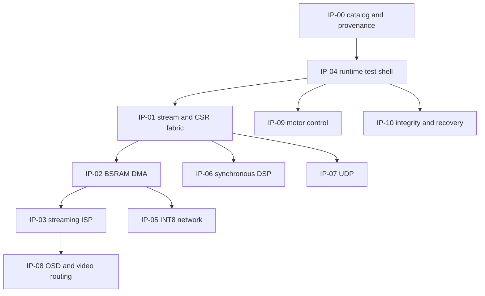

# Planned product dependencies

These are integration requirements, not claims of completed integration.
Canonical implementation identities and declared RTL dependencies are in
`ip_catalog.yaml`. Adapter and interface compatibility remains to be tested.

Stream fabric candidates: frame_switch4, width_converter, packet_async_fifo,
backpressure_isolator, axi_lite_interconnect, atomic_config, register_snapshot,
stream_credit32. Test-shell candidates: capture_replay, stream_metrics,
fault_injector, march_controller, register_snapshot, timestamp64.

Licensing release gate: existing provenance states local authorship for 72 RTL
cores but does not provide an explicit redistribution license. Preserve this
distinction. Third-party DVI netlists and Gowin primitives require separate
dependency/license entries if incorporated; neither is counted as authored IP.
